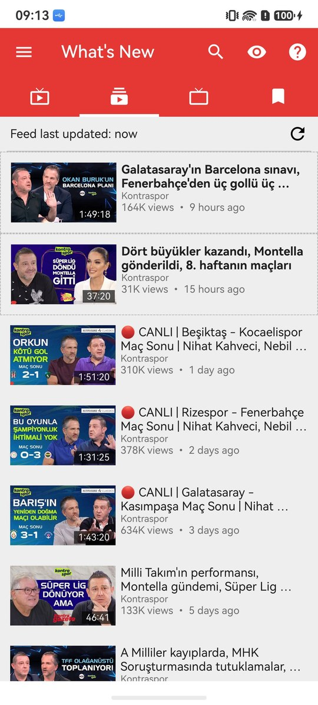
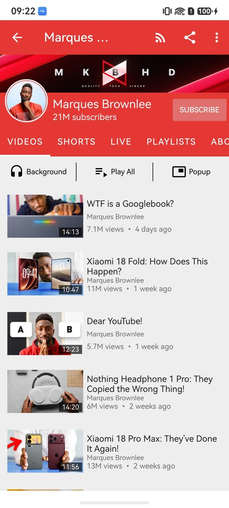
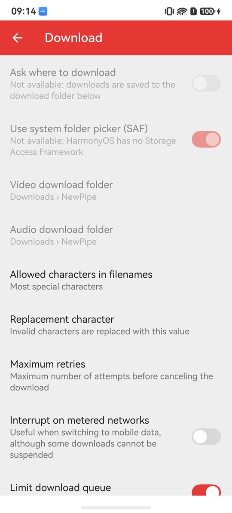

<p align="center"></p>
<h2 align="center"><b>NewPipe</b></h2>
<h4 align="center">The libre, lightweight streaming front-end for Android, rebuilt natively for HarmonyOS NEXT.</h4>

<p align="center"></p>

> ### Please read this first
>
> This is an unofficial port. It is not affiliated with, endorsed by, or supported by Team NewPipe.
> If something here is broken, it is broken here. Do not open an issue upstream for it.
>
> The name NewPipe and the app icon belong to Team NewPipe. The GPL covers the source code, not the
> name and not the artwork. Both are used here only to say what this is a port of, and both will
> change if the upstream authors would rather we did not use them.

<p align="center"><a href="#screenshots">Screenshots</a> &bull; <a href="#install">Install</a> &bull; <a href="#known-limits">Known limits</a> &bull; <a href="#function-list-comparison">Function list comparison</a> &bull; <a href="#license">License</a></p>

<hr>

NewPipe is a free and open-source streaming front-end for Android, written by Team NewPipe. It uses
no Google framework, no account and no official API key: it calls the same endpoints a service's own
website calls - YouTube's internal `youtubei/v1`, PeerTube's REST API, SoundCloud's `api-v2` - and
parses the page itself where there is no endpoint. This repository is that Android app rewritten for
HarmonyOS NEXT in ArkTS, against ArkUI.

Every layer has a counterpart here and nothing was pulled in from a third-party library - the
extractor, the HTTP downloader, the Rx layer and the database are all ported code, and
`oh-package.json5` lists no runtime dependency at all. The five services keep their ids (YouTube 0,
SoundCloud 1, media.ccc.de 2, PeerTube 3, Bandcamp 4), because they are written into every stored
subscription, playlist and history row; so do the 230 `settings_keys.xml` preference keys and the
database schema, down to its version number.

Upstream lives at [TeamNewPipe/NewPipe](https://github.com/TeamNewPipe/NewPipe). This port is based
on NewPipe for Android **0.29.1 (build 1015)**, which is also the reference build every test case
here was driven against - first on an Android handset, then replayed on the HarmonyOS one. If you
are on Android, go there instead. This port exists for people whose
phone runs HarmonyOS NEXT.

## Screenshots

<!-- Captured on the port device, Huawei BRA-AL00 / HarmonyOS 6.1. Player, feed, channel, search, settings. -->
<p align="center">





</p>

## Install

There is no prebuilt package here. You build it and sign it yourself, which also means the package
carries your certificate and your device list rather than someone else's.

You need DevEco Studio 6.x with the HarmonyOS SDK (API 20 or newer), a Huawei developer account,
and a device running HarmonyOS NEXT.

1. Clone this repository and open the folder in DevEco Studio.
2. Go to **File > Project Structure > Signing Configs**. Sign in, connect the device, and let
   DevEco generate a signature. The bundle name is `com.hmos.mobile`.
3. Build it. There is **no `hvigorw` wrapper in the repo**, so the hvigor inside DevEco Studio is
   what builds it, and it must be started from the project root - anywhere else it fails with exit
   `4294967295`:

```bash
DEVECO="/c/Program Files/Huawei/DevEco Studio"
hvigor() { "$DEVECO/tools/node/node.exe" "$DEVECO/tools/hvigor/bin/hvigorw.js" "$@"; }

hvigor --mode module -p product=default assembleHap --no-daemon
```

4. Install and launch it. The package lands in `entry/build/default/outputs/default/`:

```bash
hdc install -r entry-default-signed.hap
hdc shell aa start -a EntryAbility -b com.hmos.mobile
```

A generated debug signature only installs on the devices registered to it, and it expires. When it
does, open the same dialog and generate it again. On a machine that already has the signing
material, `devecocli run --module entry --device <id>` does the build, install and launch in one
step.

Two checks run on the host with no device:

```bash
hvigor --mode module -p module=entry@default -p product=default \
  -p buildMode=test -p coverage=false test --no-daemon
devecocli check lint
```

The test task is **not** gated by its exit code - a failed assertion prints
`ERROR: Error in <name>, <message>` and hvigor still ends `BUILD SUCCESSFUL`. Gate on zero such
lines, with no exceptions to remember. (There used to be one: `url.URL` from `@kit.ArkTS` throws
`URLSearchParams is not defined` on the host, and parses nothing even when given that class, so
the one check that needed it printed `ERROR` on every run. The suite now supplies a test-only
`URLSearchParams`, asserts that the host parser is a stub, and leaves the parsing expectations to
a runtime that has one.)

## Known limits

Twelve things this port cannot do, each because of something HarmonyOS does not give an app. The
missing capability is named so you can check it yourself.

| Limit | Missing HarmonyOS capability |
|---|---|
| **No 1440p or 2160p - they play as 1080p** | nothing above 1080p is in H.264, and only `avc1` is accepted here. The reason a codec choice decides this at all: `media.AVPlayer` plays one source and has no counterpart to ExoPlayer's `MergingMediaSource`, so the separate video and audio streams YouTube serves above 360p have to be joined by hand |
| **No pitch and no skip-silence in the speed dialog, and 0.125x is the floor** | the members themselves. `setPlaybackRate(rate: number)` is all AVPlayer has; `pitch`, `semitone` and `skipSilence` appear nowhere in `@ohos.multimedia.media` or `@ohos.multimedia.avsession` |
| **No system folder picker on a phone** | two syscaps, `…UserFileService.FolderSelection` and `…UserFileService.FolderObtain`, declared for 2-in-1 only. A syscap is part of the device image, so no certificate or permission opens it |
| **Two buttons on the media notification, not five** | a third-party notification draws at most two actions; the live-view types are system-app only; no API orders the buttons or picks a compact subset - the AVSession card's layout is fixed per session type, so the background player shows Repeat and the popup/main player show rewind and fast-forward, never both, and there is no Close button |
| **The popup's close (trash) zone only activates right at the bottom** | a say in how the PiP window is dragged or dismissed. On Android NewPipe draws the popup and its close target itself, live for the whole drag; here the popup is the system PiP window, HarmonyOS draws it and its trash hotzone, and `@ohos.PiPWindow` exposes no drag or dismiss setting |
| **No caption appearance from the system** | a system caption style for apps to follow. `accessibility.getCaptionsManager()` answers but is read-only (`@deprecated since 12`) and `enabled` is false with no setter. The phone's Settings has no caption-style screen: searching it for "Captions" lands on Celia's live captions (`Celia > Celia Captions`), which is not a style a player can follow |
| **A YouTube link tapped in another app opens the browser, not NewPipe** | handling an http/https link from outside. HarmonyOS hands those links to the browser unless the app has verified the domain through App Linking, which only the domain's owner can do. Sharing the link to NewPipe from the share panel, a `vnd.youtube:` link or `aa start -U <url>` still reaches the Open With dialog |
| **Swiping the media card away does not close the player** | a dismissal callback. The background card belongs to AVSession and the system draws it; the app is never told the card was swiped away, so only the session's stop command can end playback |
| **New-stream checks run every 20 minutes at the most, not every 15** | a shorter repeat cycle. `workScheduler` will not repeat a work item more often than every 20 minutes; picking 15 minutes in Settings runs it every 20, and the setting says so |
| **No system screen to pick the app's language** | a per-app language page in the phone's Settings that an app can open. The language is chosen from the list inside the app instead |
| **No menus or gestures inside the popup** | app content in the PiP window. `@ohos.PiPWindow` draws the window itself, sends the app no touch events and lets it add one control pair (previous/next or rewind/fast-forward) beside play/pause - so the popup has no speed, quality, audio or caption menu, no seek bar and no double-tap, pinch or long-press |
| **The media card cannot be colourised** | a way to colour the card. The system draws the AVSession card in its own colours, so *Colorize notification* is shown disabled |

One row left this list: handing a stream to another player. Nothing installed on a HarmonyOS phone
plays a remote video URL, so **Use external video player** now asks which resolution, then which
player, copies that rung to the cache and hands it over as a file - which the Video app and the
system player both open. The copy has to finish before playback starts.

## Known issues

Open problems in this build, as opposed to the limits above: these are things the port does not
do right yet, not things the platform rules out. Codes are the AVPlayer error codes the player
logs (`hilog`, tag `PlayerService`), all seen on the Mate 60 (API 24).

| Issue | What happens |
|---|---|
| **Landscape is not supported** | the app is portrait only. The one exception is the fullscreen player, which turns the window to landscape (`setPreferredOrientation`) and back to portrait when it exits. No screen has a landscape layout, and rotating the phone into fullscreen - as the reference does - is not wired. For the same reason, leave *Tablet mode* (Settings > Appearance) on Automatic: there is no tablet layout to switch to, and with it On the fullscreen player stays in portrait |
| **Some live streams and videos fail to play** | **`5411006`** `IO Request Denied: NET_ERR-server-IO error` - the server refuses the stream; some live streams never start, the player retries 10 times and gives up. **`5400106`** `Unsupported Format: CONTAINER_ERR … unsupport container format type` - AVPlayer cannot open the container it was given; seen on a live stream opened from the Next list - on branch `parity-gaps` a merged stream only takes MP4/AAC audio (an Opus track in WebM caused `5400103` `DEM_PARSE_ERR`), and a `5400103`/`5400106` now switches once to the 360p muxed stream instead of stopping |
| **Swiping the player down should keep it playing in the background** | the swipe collapses the page into the mini player and a video keeps playing. A live stream collapses too, but could not be confirmed to keep playing, because the streams tried were hitting `5411006` above |
| **Play with Kodi only offers to install Kore** | Kore, the remote app NewPipe hands the stream to, has no HarmonyOS build, so the button pauses playback and then asks to install an app that does not exist here |
| **Two ExoPlayer settings are shown but disabled** | *Use ExoPlayer's decoder fallback* and *Always use ExoPlayer's video output surface workaround* belong to Android's player library; AVPlayer has no counterpart, so the rows only explain that |
| **No "display over other apps" permission screens** | Android needs that permission for its self-drawn popup; here the popup is the system PiP window, so the permission snackbar and its explanation dialog do not exist |
| **A link opened with Always can fail to play** | **`5400102`** `Operate Not Permit: switch surface with no old surface`. After *Always* was chosen in the Open With dialog, the next `vnd.youtube:` link went straight to the main player, which showed this error with Report and Retry instead of playing |
| **Show info and Video player from the Open With dialog may not load** | after choosing *Show info* or *Video player* with *Just Once*, the video page still showed only its reload icon 6 seconds later. Whether the page is slow or has failed is not known yet |
| **Grid items are not centred** | with *List view mode* (Settings > Appearance) set to Grid, each tile sits against the left edge with the right side of the row empty, and its title runs past the thumbnail. On Android the 164 dp thumbnail is centred in its cell and the title and uploader are as wide as the thumbnail. Seen on the Live, What's New and search result lists |

Fixed on branch `parity-gaps` and checked on the Mate 60 (2026-10-15):

- `5400103` `DEM_PARSE_ERR-video/avc` on ordinary videos: the two videos that failed now open, and the page keeps the uploader row and the Add To / Background / Popup / Download buttons.
- The Comment Replies page has its toolbar again - a back arrow and the "N replies" title.
- The subscriptions picker in the channel-group dialog opens its overflow menu (*Show only ungrouped subscriptions*).
- A `vnd.youtube:` link opens the Open With dialog, whether the app is running or not.

Fixed on branch `parity-gaps`, not yet seen working on a device:

- Downloads failing with HTTP 403 after the stream URL expired (about 6 hours): a 403 now re-extracts the page and resumes with a fresh URL, as on Android. A new video download finishes; the renewal itself only shows on a URL older than about 6 hours. A download created before this build has no recovery data and keeps its 403, as on Android - delete it and download again.

## Function List Comparison

| Module | Rows | Both | Android | HarmonyOS |
|---|---:|---:|---:|---:|
| Main Screen | 8 | 8 (100%) | 0 | – |
| Navigation Drawer | 23 | 23 (100%) | 0 | – |
| Kiosk List | 20 | 20 (100%) | 0 | – |
| Stream Options | 19 | 18 (95%) | 1 | – |
| Search | 44 | 44 (100%) | 0 | – |
| Video Detail | 99 | 96 (97%) | 3 | – |
| Main Player | 74 | 65 (88%) | 9 | – |
| Popup Player | 26 | 11 (42%) | 15 | – |
| Player Notification | 12 | 9 (75%) | 3 | – |
| Play Queue | 32 | 32 (100%) | 0 | – |
| What's New | 18 | 18 (100%) | 0 | – |
| Subscriptions | 45 | 45 (100%) | 0 | – |
| Bookmarked Playlists | 39 | 39 (100%) | 0 | – |
| History | 13 | 13 (100%) | 0 | – |
| Downloads | 30 | 30 (100%) | 0 | – |
| Settings | 271 | 250 (92%) | 21 | – |
| About | 13 | 13 (100%) | 0 | – |
| Open With | 16 | 15 (94%) | 1 | – |
| Global | 15 | 15 (100%) | 0 | – |
| **Total** | **817** | **764 (94%)** | **53** | **–** |

The full table, one row per function with a note wherever the two apps differ, is in [docs/FUNCTION_LIST_COMPARISON.md](docs/FUNCTION_LIST_COMPARISON.md), and as a workbook with the same grouping as the Function List in [docs/FUNCTION_LIST_COMPARISON.xlsx](docs/FUNCTION_LIST_COMPARISON.xlsx).

## License

GPLv3, the same as upstream. `LICENSE` is the upstream file, unchanged - the GNU General Public
License, version 3. The source it was ported from carries:

```
Copyright (C) Christian Schabesberger 2016 <chris.schabesberger@mailbox.org>
```

Everything written for HarmonyOS is released under those same terms: you can use, study, share and
improve it at will. `NOTICE` lists what came over from upstream and the license of every library
that was ported into this repository rather than pulled in - NewPipeExtractor under the GPL, RxJava,
Markwon and PrettyTime under Apache 2.0, jsoup under MIT, and NewPipe's fork of
NoNonsense-FilePicker under the MPL.

More about NewPipe: [newpipe.net](https://newpipe.net/)
